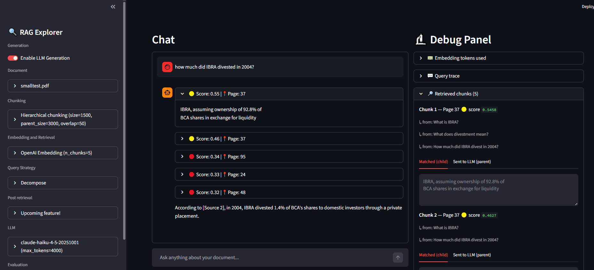

# RAG Explorer

Try every RAG configuration and find the best for your needs. Upload a document and tinker the settings.

The debug panel shows exactly what happened like which chunks were retrieved, what scores they got, how the query was transformed, which steps ran, and what each step cost in tokens.



---

## What it does

- Upload any PDF and index it with your chosen configuration
- Ask questions and get answers grounded in the document
- Explore how different RAG settings change retrieval quality
- Use it without an LLM API key as generation is optional

---

## Setup

Needs Python 3.10 or newer.

```bash
git clone https://github.com/justinjedidiah/rag-explorer
cd rag-explorer
pip install -r requirements.txt
streamlit run app.py
```

API keys are optional, the retrieval process will still run even with no generation.
Optionally, you can use your keys on the app (sidebar → API keys) or create a `.env` file for your keys to prevent copy pasting over and over:

```
ANTHROPIC_API_KEY=sk-ant-...
OPENAI_API_KEY=sk-...
HF_TOKEN=hf_...        # only for gated or private embedding models
```

Local embedding models and the reranker are downloaded from Hugging Face the first time you use them.

---

## What you can configure

Chunking and embedding settings are baked into the index. When you change one of them after indexing, the sidebar tells you to index the document again. Everything else applies to your next question.

### Chunking
How the PDF is split before indexing.

| Strategy | How it works |
|---|---|
| Fixed size | Splits by character count. Fast and simple, but cuts mid-sentence. |
| Semantic | Splits on paragraph, then sentence, then word boundaries. Better context per chunk. |
| Hierarchical | Indexes small chunks for precise matching, but returns the full parent paragraph to the LLM. |

---

### Embedding and retrieval

How chunks are represented and searched.

| Mode | How it works |
|---|---|
| Dense | Embeds chunks and compares meaning (cosine similarity). |
| Sparse | BM25 keyword matching, no neural model. Wins on exact terms, names, codes. |
| Hybrid | Runs both and mixes the scores. The dense weight slider sets the balance. |

| Dense model | Notes |
|---|---|
| all-MiniLM-L6-v2 | Free, fast, runs locally. Good starting point. |
| BAAI/bge-small-en-v1.5 | Free, local, better quality than MiniLM at a similar size. |
| BAAI/bge-large-en-v1.5 | Free, best local quality, slow and a 1.3 GB download. |
| OpenAI Embedding | Paid, high quality. Requires OpenAI API key. |

BM25 has options for language, stemming and stopwords.

**Rerank with cross-encoder** retrieves a wider set of candidates (20 by default), scores each one against your question with a cross-encoder, and keeps the best. Slower, but more accurate than comparing embeddings.

**Index hypothetical questions** is HyDE turned around. Instead of turning your question into a fake answer, an LLM writes the questions each chunk answers at indexing time, and those questions are indexed in place of the chunk text. Your question is then matched against questions. It costs one LLM call per chunk when indexing, and HyDE is switched off while it is active.

---

### Query strategy

Transforms the user's question before retrieval. Can significantly improve what gets found.

| Strategy | What it does | Requires LLM |
|---|---|---|
| None | Raw question goes straight to retrieval | No |
| Rewrite | LLM rewrites the question for better search clarity | Yes |
| HyDE | LLM generates a fake answer, that answer is embedded and used for search | Yes |
| Decompose | LLM splits complex questions into sub-questions, retrieves for each, merges results | Yes |

---

### Post retrieval

Runs on the retrieved chunks before they go to the LLM.

| Step | What it does | Requires LLM |
|---|---|---|
| Corrective RAG | LLM judges the chunks and drops the ones that do not help answer the question | Yes |
| Contextual compression | LLM cuts each chunk down to the sentences relevant to the question | Yes |
| Chunk positioning | Puts the best chunks first and last in the prompt and the weakest in the middle | No |

---

### LLM

Claude or OpenAI. With an API key set, the model dropdown is loaded live from the provider (refreshed hourly), so new models appear without updating the app. Without a key, or when the provider cannot be reached, a short built-in list is shown. The OpenAI embedding model dropdown works the same way.

OpenAI lists every kind of model in one place, so chat models are picked out by name. If a model in the dropdown turns out not to support chat, the error shows up in the chat instead of crashing the app.

---

## The debug panel

Every question shows a full trace of what happened:

- **Tokens used** — LLM tokens per step for the question, plus embedding and indexing tokens for the document
- **Query trace** — the original question, and how it was transformed (rewritten, HyDE document, or sub-questions)
- **Retrieved chunks** — each chunk with its page number, score, and which sub-question or hypothetical question retrieved it. Tabs show each version of a chunk (matched child, parent, compressed) and which one was sent to the LLM
- **Dropped by Corrective RAG** — the chunks the LLM judged irrelevant
- **Process log** — which steps ran, which were skipped, and why

Score colors apply to cosine and reranker scores, which are on a 0 to 1 scale: 🟢 high (≥0.7) · 🟡 medium (≥0.4) · 🔴 low (<0.4). BM25 and hybrid scores show ⚪ because they only mean something relative to each other.

---

## Project layout

```
app.py                  Streamlit UI only
pipeline.py             build_index() and answer_question(), usable without the UI
ingestion/              PDF loading and chunking
indexing/               embedding models, BM25, Chroma store, hypothetical questions
query/                  query strategies
retrieval/              search, hybrid fusion, reranker, post-retrieval steps
generation/             LLM wrapper (Claude and OpenAI) with token tracking
```

---

## Not built yet

- RAGAS evaluation
- SPLADE (sparse) and ColBERT (late interaction) retrieval
- Multilingual and code embedding models
- Caching of embeddings and LLM calls
- OCR for scanned PDFs
